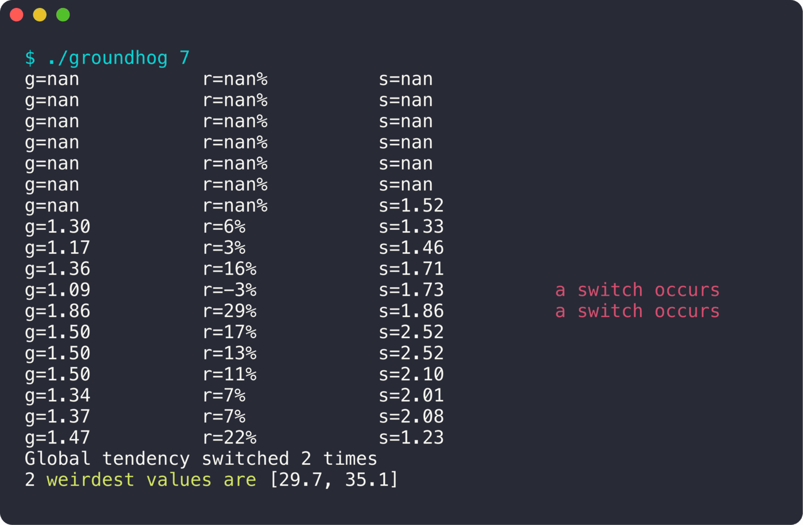

<div align="center">

# Groundhog

**Analyser une série de températures en temps réel.**

  

<sub>Projet à 2 · 2024</sub>

</div>

<br/>

<p align="center"></p>

## Le projet en quelques mots

On saisit des températures une par une, et le programme calcule au fur et à mesure la tendance, l'évolution et l'écart-type sur une période glissante. À la fin, il dit combien de fois la tendance s'est inversée et quelles valeurs étaient les plus étranges.

## Ce que ça fait

- Lecture des valeurs une par une jusqu'à `STOP`
- Sur la période : hausse moyenne `g`, évolution `r` en %, écart-type `s`
- Détection des changements de tendance (*a switch occurs*)
- Les valeurs les plus aberrantes de la série (*weirdest values*)
- Tests unitaires Criterion

## Lancer le projet

```bash
make
./groundhog 7
# puis une température par ligne, et STOP pour finir
```

## L'équipe

<a href="https://github.com/Wilson-Epitech/groundhog/graphs/contributors"></a>

Bradley Malbrouck, Wilson Bordichon

**Ma partition :** J'ai fait la lecture des entrées, la gestion d'erreurs, le calcul de l'évolution et les tests unitaires.
